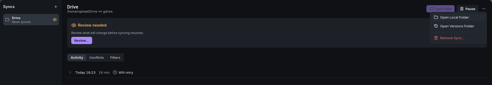

<p align="center">
  
</p>

<h1 align="center">syncfast</h1>

<p align="center"><strong>Two-way sync between a folder and Google Drive, with a review before anything is deleted.</strong></p>

<p align="center">
  <a href="#install"><strong>Install</strong></a> ·
  <a href="docs/guide/getting-started.md">Guide</a> ·
  <a href="docs/agents.md">Agents</a> ·
  <a href="CONTRIBUTING.md">Contributing</a>
</p>

<p align="center">
  
</p>

## What it is

syncfast keeps folders on your computer in sync with Google Drive, in both directions, from one tray window. It runs [rclone bisync](https://rclone.org/bisync/) for you, on a schedule and whenever local files change, with systemd user units it generates.

The first sync of a folder, a changed filter set and any round that would delete many files stop and wait for you to review what will change. Files replaced on this computer are kept for 30 days. Read [PRODUCT.md](PRODUCT.md) for what syncfast is and is not.

## Install

syncfast ships only as a Flatpak. It bundles rclone and needs `flatpak` and your user's systemd, nothing else.

```sh
flatpak remote-add --user --if-not-exists flathub https://dl.flathub.org/repo/flathub.flatpakrepo
flatpak install --user https://raphael-soares.github.io/syncfast/io.github.raphael_soares.syncfast.flatpakref
flatpak run io.github.raphael_soares.syncfast
```

`flatpak update` brings later releases. Each [GitHub Release](https://github.com/raphael-soares/syncfast/releases) also carries the bundle for an offline install.

## First steps

1. Open syncfast and press **Get Started**.
2. Add your Google Drive account with your own OAuth client ID ([how](docs/guide/google-drive.md)).
3. Choose a folder on Drive and a folder on this computer, then **Create Sync**.
4. Review the first sync. After you confirm it, syncfast keeps both sides equal by itself.

The full walkthrough is in [Getting started](docs/guide/getting-started.md). If something stops, see [Troubleshooting](docs/guide/troubleshooting.md) and [Privacy](docs/guide/privacy.md).

## AI agents

An agent can do everything you can do in syncfast except sign in. The `syncfast` command takes `--json` everywhere, and `syncfast mcp` serves the same operations as MCP tools:

```sh
claude mcp add syncfast -- flatpak run --command=syncfast io.github.raphael_soares.syncfast mcp
```

An agent can never confirm a review that deletes files. The guide an agent should follow is [docs/agents.md](docs/agents.md), also printed by `syncfast agent-guide`.

## License

[MIT](LICENSE). Bundled and linked third-party software is listed in [THIRD-PARTY-NOTICES.md](THIRD-PARTY-NOTICES.md).
