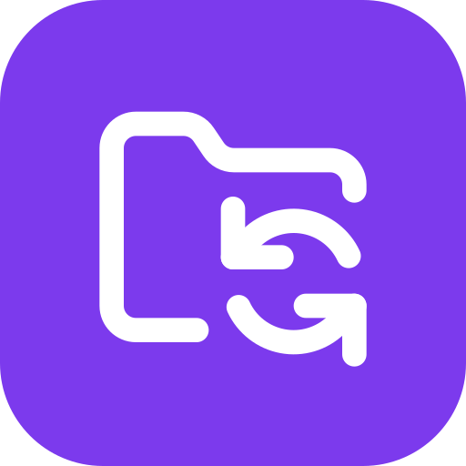
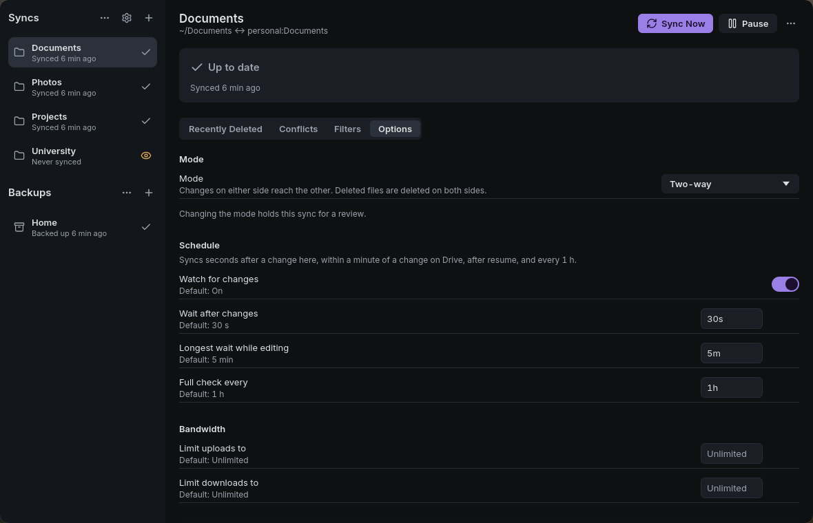
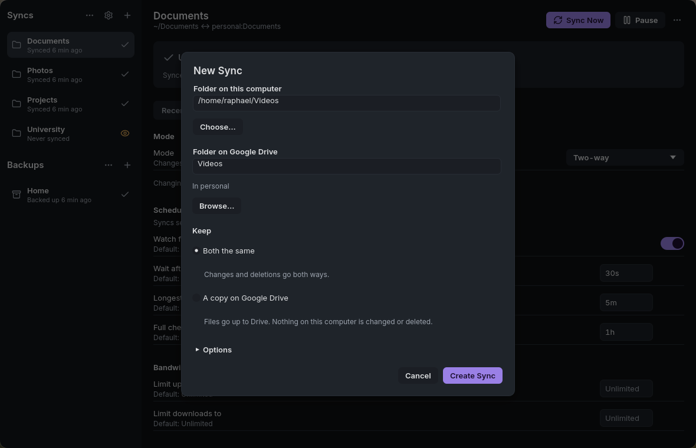
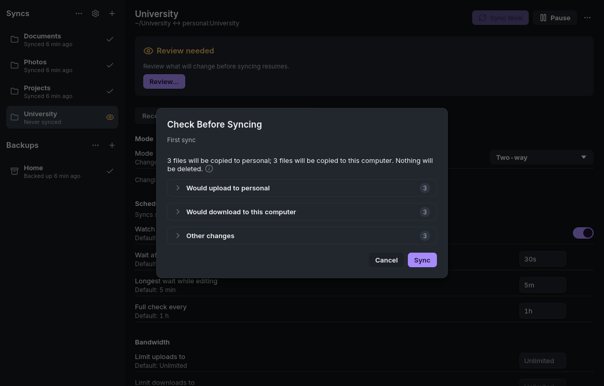
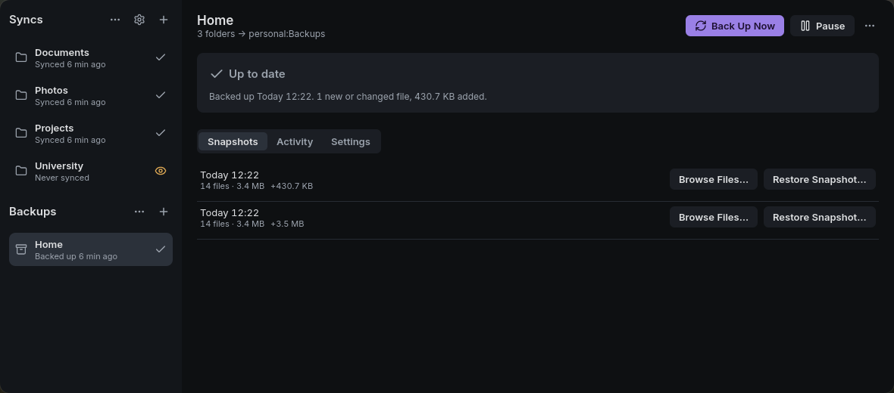

<p align="center">
  
</p>

<h1 align="center">syncfast</h1>

<p align="center"><strong>Google Drive on Linux, the way it should be: real folders on disk, synced both ways, and nothing deleted without your OK.</strong></p>

<p align="center">
  <a href="#install"><strong>Install</strong></a> ·
  <a href="docs/guide/getting-started.md">Guide</a> ·
  <a href="#for-power-users">CLI and agents</a> ·
  <a href="CONTRIBUTING.md">Contributing</a>
</p>

<p align="center">
  
</p>

## What you get

- **Your files, offline.** Pick a folder on your computer and a folder on Drive. Both hold real files, so everything opens without a network, in any app.
- **Two-way or a copy.** Changes go both ways, or files only go up to Drive and nothing on your computer is touched. A sync starts seconds after you save, and also runs on a schedule.
- **No surprise deletions.** The first sync tells you in one sentence what it will copy and delete, and waits for your OK. Later, a round that would delete files with no way back stops and asks. Whatever a sync deleted or replaced shows in **Recently Deleted**, one click from coming back.
- **Encrypted backups.** Keep versioned snapshots of the folders you choose on Drive or on a disk, encrypted with a key only you have, and restore any of them.
- **Quiet in the background.** A tray icon, a notification when something needs you, and on Nautilus, sync emblems and a **Sync with Google Drive…** menu item.

## Why not something else

- **Insync** does this well, and it is paid.
- **GNOME Online Accounts** shows Drive in Files, but only online: there is no copy on disk.
- **rclone** is what syncfast runs underneath. On its own it is a command line tool, and a wrong flag can wipe both sides. syncfast fixes the flags and puts a review in front of anything risky.

## Before you start

Google makes every app that reads Drive sign in with its own OAuth client, and a small open source app cannot get a shared one approved. So you create yours, once: it is free, takes about 5 minutes, and syncfast walks you through every step with a link to the right page. [Why and how](docs/guide/google-drive.md).

## Install

syncfast ships as a Flatpak for any Linux distribution. It bundles everything it needs.

```sh
flatpak remote-add --user --if-not-exists flathub https://dl.flathub.org/repo/flathub.flatpakrepo
flatpak install --user https://raphael-soares.github.io/syncfast/io.github.raphael_soares.syncfast.flatpakref
flatpak run io.github.raphael_soares.syncfast
```

`flatpak update` brings later releases. Each [GitHub Release](https://github.com/raphael-soares/syncfast/releases) also carries the bundle for an offline install.

## First steps

1. Open syncfast and press **Get Started**.
2. Connect your Google account with the client you created ([how](docs/guide/google-drive.md)).
3. Choose a folder on this computer; the folder on Drive follows its name. Then **Create Sync**.
4. Check what the first sync will do and confirm. From then on syncfast keeps both sides equal by itself.

<p align="center">
  
  
</p>

The full walkthrough is in [Getting started](docs/guide/getting-started.md), backups in [Backups](docs/guide/backup.md). If something stops, see [Troubleshooting](docs/guide/troubleshooting.md). What syncfast sends and stores is in [Privacy](docs/guide/privacy.md). On Arch with Nautilus, [emblems and the menu items](docs/guide/nautilus.md) are optional.

<p align="center">
  
</p>

## For power users

Everything in the window is also a command: `syncfast` takes `--json` everywhere, and `syncfast mcp` serves the same operations to AI agents as MCP tools.

```sh
claude mcp add syncfast -- flatpak run --command=syncfast io.github.raphael_soares.syncfast mcp
```

An agent can do anything you can except sign in, and it can never confirm a review that deletes files. The guide an agent should follow is [docs/agents.md](docs/agents.md), also printed by `syncfast agent-guide`.

## How it works

syncfast runs [rclone bisync](https://rclone.org/bisync/) for syncs and [restic](https://restic.net/) for backups, both bundled in the Flatpak, and schedules them with systemd user units it generates. Your account credentials stay in your rclone config. There is no syncfast account, server or telemetry. [PRODUCT.md](PRODUCT.md) says what syncfast is and is not.

## License

[MIT](LICENSE). Bundled and linked third-party software is listed in [THIRD-PARTY-NOTICES.md](THIRD-PARTY-NOTICES.md).
